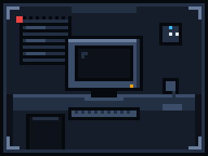
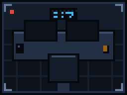

# Night Shift Help Desk

> **Kiroween 2026 — Costume Contest Entry**  
> **Live Demo:** https://pakorn269.github.io/night-shift-help-desk/  
> *You are the only analyst on the night shift. A workstation powered on by itself at 03:00. Your audit log says you closed the ticket at 03:07. It is still 03:00.*

**Night Shift Help Desk** is a browser-based psychological horror game disguised as **Halcyon Desk // ITSM v4.2**—a hauntingly authentic midnight enterprise service console whose interface quietly turns against you. Instead of pasting Halloween clip art over a generic web app, **the workplace software itself is the costume and the horror**: clocks drift seven minutes forward, phantom tickets ring from your own VoIP extension, CCTV pixel feeds reveal someone sitting at your desk, and your own analyst badge splits into two silhouettes.

  

## Features

- **3 Escalating Night-Shift Cases (~3–5 minutes)** separated by a haunting 7-minute motif (`03:00` → `03:14` → `03:21`):
  1. **`INC-0300` — Workstation Powered On Unexpectedly**: Inspect the forensic audit trail to uncover an impossible `03:07` closure signed with **your own analyst name**. Choose to trust the log (time jumps to `03:07`, duplicate closures appear, coffee freezes) or challenge it (original entry vanishes, phantom ticket `INC-0419` injects into your queue, VoIP desk phone rings from your own extension).
  2. **`INC-0314` — Badge Swipe From an Empty Stairwell**: Your RFID badge `#0419` unlocks the Floor 4 North Stairwell while docked on your desk—and the audit log remembers your Case 1 choice.
  3. **`INC-0321` — Shift Handover Request**: Submitted by your own extension, listing your actual Case 1 and Case 2 decisions **pre-dated at `02:55`** before you even logged in.
- **4 Persistent Unlockable Shift Endings** (`The Quiet Shift`, `Extension 419`, `Split Session`, `Audit Exception`) tracked in a `localStorage` Shift Dossier so players can hunt every branch.
- **Shift Check-In & Personalizable Analyst Handle**: Clock in at `03:00` with your own name (or edit it live in the console header) so **your name** appears inside impossible future timestamps, VoIP transcripts, and shift endings.
- **Interactive VoIP Handset Pickup & 6× CCTV Forensic Zoom**: Answer the ringing `Ext. 419` desk phone (`[P]`) to hear muffled loopback keystrokes and uncover a hidden transcript; click any live pixel CCTV feed (`[Z]`) to inspect it crisp at 6× magnification.
- **Shareable Shift Report Card**: Export your unlocked ending & 3-case audit ledger straight to your clipboard from the End-of-Shift Dossier.
- **Bespoke Piskel MCP Pixel Art Suite**: 8 cohesive 16-color Phosphor-Noir animated sprite sheets (`64×48` live CCTV feeds for all 3 cases, `32×32` Halcyon emblem, deteriorating analyst ID badge, ringing VoIP handset, `24×24` steaming/frozen coffee mug, and 6 colorblind-safe status icons) rendered crisp with `image-rendering: pixelated`.
- **Procedural Web Audio Mixer (`src/audio.ts`)**: Zero external audio files. Bus-routed Web Audio API synthesizer (`Master ← {Ambience, SFX, UI}`) with squared slider-to-gain volume mapping, soft master limiting, adaptive vertical dread drone layering, muffled VoIP ring bursts, and pitch-randomized mechanical clicks.
- **Accessibility & Craft First**: Zero jump scares, zero strobing flashes, zero audio-only or color-only clues, full keyboard navigation + single-key shortcuts (`I`, `1`/`2`, `N`, `R`, `M`), live **Calm (Reduced Motion)** toggle, and mobile-first responsive layout verified down to `360px`.

## Quick Start

```bash
# Install dependencies
npm install

# Run local development server (http://localhost:5173/)
npm run dev

# Run automated test suite (unit + fast-check property + integration tests)
npm test

# Build production static bundle into dist/
npm run build

# Regenerate all Piskel pixel art sprites via Piskel MCP Server
npm run sprites
```

## Architecture

```text
.kiro/
├── specs/first-playable-slice/   # Original Kiro spec (requirements, design, tasks)
├── steering/                     # Product, tech, and Costume Contest UI steering docs
└── hooks/                        # Agent hook verifying tests & build on edit
docs/
├── art-direction-brief.md        # 16-color Phosphor-Noir palette & sprite bible
├── game-brief.md                 # Original concept & scope
└── DEVPOST_SUBMISSION.md         # Kiroween submission pitch & <3m demo video script
public/sprites/                   # Crisp Piskel MCP pixel art sheets, icons & asset-manifest.json
scripts/
└── generate-piskel-sprites.mjs   # Reproducible Piskel MCP JSON-RPC sprite generator
src/
├── types.ts                      # Strict discriminated-union domain types
├── content.ts                    # Centralized copy & narrative tables (easy to localize)
├── state.ts                      # Pure FSM + derived selectors (clock, dread, CCTV, audit)
├── storage.ts                    # Versioned crash-safe localStorage profile & ending tracker
├── audio.ts                      # Procedural Web Audio bus mixer & adaptive dread ambience
├── juice.ts                      # Proportional trauma micro-shake & phosphor dip (Calm-safe)
├── renderer.ts                   # Event-driven DOM & Piskel sprite renderer
├── accessibility.ts              # Logical focus management & keyboard shortcuts
├── main.ts                       # Application orchestrator
└── *.test.ts                     # 6 test suites (unit, property-based fast-check, integration)
```

## License

Released under the [MIT License](LICENSE).
